# Manuale operativo — Orario CdS (Fisica, UniPi)

Web app per costruire e revisionare l'**orario didattico** del Corso di Studi:
calendario settimanale, vista per aula, editing grafico degli slot, rilevamento
delle **collisioni** (con funzione di costo basata sui co-esami), **conflitti
docente** ("obiquità"), **capienza delle aule** e una **matrice dei co-esami**.

> Gli screenshot di questo manuale sono generati da una build di anteprima con
> dati di esempio (`scripts/build_manual_screens.js`); l'interfaccia reale è
> identica, cambiano solo i dati.

---

## Indice

1. [Cos'è e come è fatto](#1-cosè-e-come-è-fatto)
2. [Il gsheet sorgente](#2-il-gsheet-sorgente)
3. [Aprire la web app · Carica / Salva](#3-aprire-la-web-app--carica--salva)
4. [I tab della web app](#4-i-tab-della-web-app)
   - [Calendario](#calendario) · [Aule](#aule) · [Slot](#slot) ·
     [Collisioni](#collisioni) · [Docenti](#docenti) · [Co-esami LM](#co-esami-lm) ·
     [Co-esami LT](#co-esami-lt) · [S1LT / S1LM (specchio)](#s1lt--s1lm-specchio)
5. [Capienza delle aule](#5-capienza-delle-aule)
6. [Funzione di costo e matrice co-esami](#6-funzione-di-costo-e-matrice-co-esami)
7. [Pipeline della matrice (tool Python)](#7-pipeline-della-matrice-tool-python)
8. [Pubblicazione e deploy](#8-pubblicazione-e-deploy)
9. [Struttura del codice e verifiche](#9-struttura-del-codice-e-verifiche)
10. [Rigenerare gli screenshot del manuale](#10-rigenerare-gli-screenshot-del-manuale)

---

## 1. Cos'è e come è fatto

- È una **Google Apps Script** *bound* (legata) al gsheet dell'orario, esposta
  come **web app** (`doGet` → `index.html`).
- A ogni apertura la web app legge uno **snapshot** salvato nelle *Script
  Properties* (3 bucket: **LT**, **LM**, **PDS**), così la pagina carica in fretta
  senza rileggere il foglio ogni volta.
- Le modifiche grafiche (drag, resize, nuovo slot, "non disponibile") sono
  **locali** finché non premi **Salva**: a quel punto vengono scritte sui fogli
  `SxLT`/`SxLM` e rigenerato il foglio `SxAULE`.
- Il progetto è replicato su **3 installazioni** (3 gsheet + 3 script + 3 web app),
  gestite insieme da `npm run deploy` (vedi §8).

I dati che il client riceve (oggetto `data`) includono: sessioni, corsi, piani di
studio (PdS), aule + capienze, matrice co-esami, colori dei vincoli, ecc.

---

## 2. Il gsheet sorgente

Fogli per **semestre e corso di studi**: `S1LT`, `S1LM`, `S2LT`, `S2LM`
(1°/2° semestre, Triennale/Magistrale). Colonne rilevanti (la prima riga è di
intestazione):

| Col | Campo | Note |
|----|-------|------|
| C | **Codice** | codice insegnamento (es. `001AB`, `401B`) |
| D | Codice mutuato | se valorizzato, la riga è una *mutuazione* |
| E | Insegnamento | titolo del corso |
| F | Tipo | `LEZ`, `LAB`, … |
| G | Vincolo | `OBB` (obbligo) / `FOR` (forchetta) / `OPZ` |
| H | Gruppo | es. `A`, `A1` (canali) |
| **J** | **Docenti** | **più docenti possibili**: il **1°** è il *titolare* (mostrato <u>sottolineato</u> nella web app), gli altri *co-docenti*. Separatori: a capo, `/`, `;`, `,`, " e ". Confronto **case-insensitive** (es. "Rossi" = "ROSSI"); evita la virgola *dentro* un nome. Menu **🛠️ Gestione tabelle → 👤 Normalizza docenti** riscrive la colonna in forma pulita: *Cognome Nome* (Title Case), spazi normalizzati, separatore `/`, iniziali puntate (es. `rossi  m` → `Rossi M.`) e maiuscola dopo l'apostrofo (`d'elia` → `D'Elia`). |
| K | SSD | settore scientifico-disciplinare |
| L–Q | LUN…SAB | celle calendario: `Aula · HH:MM-HH:MM` |
| R | Periodo | testo libero |

- **`SxAULE`**: foglio rigenerato automaticamente al salvataggio; nella colonna del
  nome aula, la **2ª riga (dopo il nome, a capo) è la capienza** (un numero) — usata
  per il controllo di sovraffollamento.
- **`MATRICE`**: foglio di **sola lettura** alimentato via `=IMPORTRANGE(...)` dal
  gsheet *fisso* della matrice co-esami (vedi §6–§7). Non scriverci a mano.

---

## 3. Aprire la web app · Carica / Salva

Apri l'URL `/exec` della web app (vedi §8). In alto: titolo **"Bozza - <nome
gsheet>"**, campo **Cerca** (codice / nome / docente), filtri **livello**
(Triennale/Magistrale), **anno**, **gruppo**, e i selettori **Aule/Labs**.

- **📥 Carica dal gsheet** — rilegge il foglio e aggiorna lo snapshot (pannello a
  destra). Usa questo se hai modificato il gsheet a mano.
- **📤 Salva sul gsheet** — scrive le modifiche pendenti su `SxLT`/`SxLM`,
  rigenera `SxAULE`, riscrive lo snapshot.
- **🅿️ Parking** (a destra): area dove "appoggiare" uno slot mentre lo sposti.
- **Log modifiche** (a destra): elenco delle modifiche pendenti prima del salvataggio.

Il badge **GRAPHICAL EDIT** sui tab Aule/Slot indica che sei in modalità modifica.

#### Toggle EDIT / VIEW e lock (un solo editor per volta)

In alto a destra, a sinistra del toggle, è indicato il **Ruolo** (in grassetto):
**Consultazione** (utente generico), **Revisore** (sola lettura) o **Editore**. Solo per
l'**Editore** segue lo stato dell'edit: *nessuno sta editando* / *xyz@unipi.it sta
editando* / *tu stai editando* (aggiornato in **polling ogni 5 min**). E, sempre solo
per gli editor, l'interruttore **EDIT / VIEW** (semaforo: verde EDIT, arancione VIEW).

- **Default = VIEW** (sola lettura, come un *Revisore*): anche gli editor partono in
  visualizzazione, con tutti i tab ma senza drag/Carica/Salva.
- **EDIT** acquisisce un **lock**: può editare **un solo utente per volta**. Se un
  altro sta già editando, il tasto EDIT è disabilitato (e un avviso lo segnala).
- Passando da **EDIT a VIEW** con **modifiche non salvate**, viene chiesta conferma
  (le modifiche andrebbero perse).
- Il lock ha una **scadenza** (**24 h**, rinnovata automaticamente mentre la scheda è
  aperta): se un editor chiude la scheda senza uscire, si libera da solo entro 24 h.
  Per sbloccarlo subito → menu **🕒 Orario → 🔓 Sconnetti editor** (vedi §8).
- **Sicurezza del Salva**: se l'edit ti viene tolto (sblocco forzato o lease scaduto)
  mentre sei ancora in EDIT, il **Salva è rifiutato** dal server (per non sovrascrivere
  il lavoro di chi ha preso l'EDIT) e ricevi un avviso; basta ricaricare e riapplicare
  le eventuali modifiche non salvate.

### Livelli di accesso (foglio CONFIG)

Tre livelli, decisi dal foglio **CONFIG** in base all'email Google dell'utente.
Nel foglio: **colonna B** = etichette di sezione, **colonna C** = email (la prima
email è sulla stessa riga dell'etichetta, le altre nelle righe sotto con B vuota):

| Sezione (col. B) | Chi è | Cosa può fare |
|---|---|---|
| **WebEditors** | redattori dell'orario | tutto: vede tutti i tab, **drag&drop**, **Carica/Salva**, badge GRAPHICAL EDIT |
| **WebAuditors** *(o `WebRevisori` / `WebReviewers`)* | **Revisori** | vedono **tutti i tab** ma in **sola lettura** (niente drag, niente Carica/Salva) |
| *(chiunque altro)* | utente UniPi generico (**Consultazione**) | vede il **Calendario** e il tab **Slot** (gli altri tab no). Lo Slot è in **sola lettura** ma gli slot restano **selezionabili**: cliccandoli si vedono le **informazioni dettagliate** (collisioni/capienza); niente drag/resize né creazione/eliminazione slot. Con i filtri (un Piano di Studi / anno alla volta) |

> Retro-compatibilità: l'etichetta dei revisori può essere **`WebAuditors`**,
> **`WebRevisori`** o **`WebReviewers`** (tutte valide). Se il CONFIG non ha
> **nessuna** etichetta di
> sezione, tutte le email in colonna C valgono come **WebEditors** (vecchio formato).

#### Visibilità pubblica (interruttore)

Dal gsheet, menu **🕒 Orario → 👁️ Visibilità** con due voci a spunta (`●` = attiva):

- **Pubblicato** (default) — l'utente generico vede il Calendario e il tab Slot.
- **In redazione** — l'utente generico vede l'**intestazione** (titolo + controlli
  disattivati, così sa di essere nel posto giusto) e, al posto del calendario, il
  messaggio **"Calendario in fase di redazione"** (i dati dell'orario non gli vengono
  nemmeno inviati). **WebEditors** e **Revisori** continuano a vedere tutto, così
  possono lavorare a sito "nascosto". L'interruttore è globale (vale per tutti gli
  utenti generici) ed è memorizzato nello script (ScriptProperty `publicVisibility`).

#### Feedback / segnalazioni (interruttore + foglio FEEDBACK)

Dal gsheet, menu **🕒 Orario → 💬 Feedback** con due voci a spunta: **Attivo** /
**Non attivo** (default non attivo). Quando è **Attivo**, in fondo ai selettori (a
destra del filtro Gruppi) compare il tasto **💬 Feedback** — visibile a **chiunque**
(editor, revisore, pubblico). Se però la **Visibilità** è *In redazione*, il feedback è
**automaticamente chiuso** (tasto nascosto per tutti): si raccolgono segnalazioni solo
a calendario pubblicato. Premendolo si apre un overlay dove l'utente può:

- scrivere una **nuova segnalazione** (campo multiriga) e premere **Invia** → viene
  aggiunta una riga al foglio **`FEEDBACK`** con *Timestamp*, *email* dell'utente, il
  testo, e *Stato* = **Aperta**;
- vedere e **modificare le proprie segnalazioni** precedenti (filtrate per email),
  ciascuna con i tasti **Aggiorna** ed **Elimina** a destra del campo (e l'eventuale
  *Risposta* del gestore, in sola lettura). Un aggiornamento riporta lo *Stato* a
  **Aperta**; **Elimina** rimuove la riga dal foglio (con conferma).

Il foglio `FEEDBACK` (colonne **A** Timestamp · **B** email · **C** Feedback ·
**D** Risposta · **E** Stato · **F** Commenti) va creato nel gsheet di ogni
installazione in cui attivi la funzione. *Risposta* e *Stato* (es. `CLOSED`) sono
campi del gestore; la colonna *Commenti* è **riservata agli amministratori** e **non**
viene mostrata né inviata all'utente.

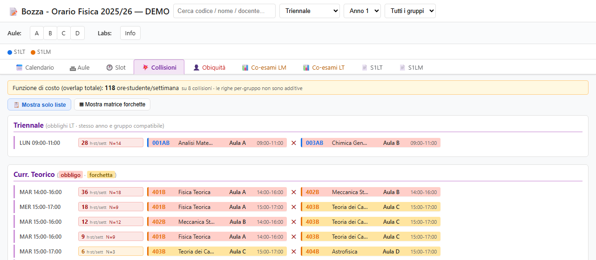

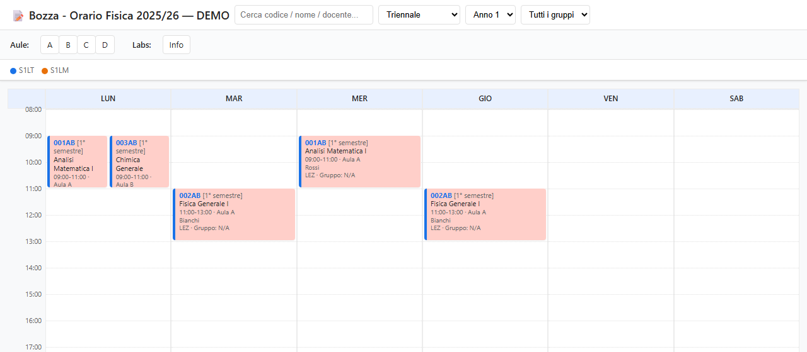

---

## 4. I tab della web app

### Calendario

Griglia settimanale LUN–SAB con i blocchi-sessione (codice, titolo, **aula**,
gruppo). L'**orario** è dato dalla posizione nella griglia; **docenti** e **tipo**
(lezione/laboratorio/…) non sono mostrati nel blocco per non sovraccaricarlo, ma
restano nel **tooltip** al passaggio del mouse. Filtri attivi in alto; clic su
un'aula in alto = mostra solo quell'aula.

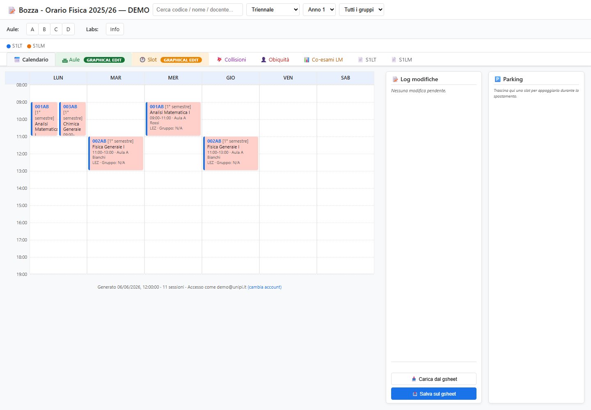

### Aule

Stessa settimana ma **per aula** (una colonna per aula). Mostra anche le zone
**NON DISPONIBILE** (manutenzioni, ecc.). In modifica puoi trascinare/ridimensionare.

> Nei blocchi piccoli di **Aule** e **Slot**, se il titolo contiene "/" (es.
> *"English title / Titolo italiano"*) si mostra solo la parte **prima della "/"**
> (l'inglese); il titolo completo resta nel tooltip e in tutte le altre viste.

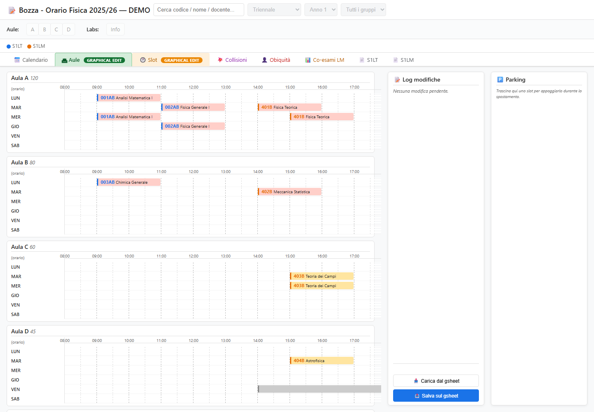

### Slot

Vista **per giorno**: una colonna per aula, con la **capienza** nel sottotitolo.
È la vista di editing fine: **+ Nuovo slot**, **Cestino**, mostra solo Aule/Labs,
espandi tutto. Nel blocco, sotto codice e titolo, si mostrano i **CFU** (l'orario è
ovvio dalla posizione; durante un drag/resize il blocco mostra però l'orario live).
Per esportare, usa il bottone **📄 Save view as PDF** in alto fra i filtri (visibile a
**tutti** gli utenti): salva **la vista corrente** in PDF **A4** — Calendario/Aule/Slot in
**orizzontale**, gli altri tab in **verticale** — con un'intestazione (a sinistra
*Bozza - <nome del gsheet> · vista · filtri attivi*, a destra *PDF generated on GG/MM/AAAA*). Stampa **solo** il
contenuto della vista (niente toolbar, **Log**, **Parking** né le **evidenziazioni di
collisione/selezione**) e adatta il contenuto alla pagina (zoom automatico), evitando di
tagliare a metà blocchi/aule/righe. Specifiche per vista: il **Calendario** entra con
**tutti i giorni (LUN-SAB)** e le **ore a sinistra**; lo **Slot** stampa **solo le Aule** in
una banda e **solo i Labs** in una banda sotto (tutto nella pagina). Nella finestra di stampa
scegli **"Salva come PDF"** (formato/orientamento già impostati; la scala si regola lì se serve).
>
> **Calendario, set multipagina.** Dal tab **Calendario**, se il campo **ricerca è vuoto**, il PDF
> contiene **un calendario per pagina**: Triennale **Anno 1**, **Anno 2**, **Anno 3**, poi **ogni
> Piano di Studi**. Se invece hai una **ricerca attiva** (es. un cognome docente), salva **solo
> quella vista**. (Le pagine senza lezioni vengono saltate.)
Gli slot che **superano l'80% della capienza** sono segnalati da un **triangolo ⚠**
(in basso a destra dello slot, vedi §5). Selezionando uno slot, nel pannello in basso
compaiono il dettaglio del codice — con **ore/settimana** (LEZ + LAB) e **CFU** — le sue
collisioni e la capienza; inoltre, **esattamente come durante il drag**, nella colonna
«Ora» compaiono le **lineette di collisione** del docente (rossa = a Fisica, viola =
servizio), i **pallini co-esame** su tutti gli slot in collisione e gli slot **sorgente**
vengono cerchiati. *(Avviando il **trascinamento** di uno slot la selezione passa subito a
quello slot, spegnendo la precedente.)* In selezione, **passando il mouse su
una lineetta** un tooltip indica **chi** è il docente in comune e **quale** evento è in
conflitto (corso · aula · orario, o l'impegno di servizio). In fondo al pannello, sotto gli
altri slot dello stesso codice, una sezione **«Impegni dei docenti coinvolti»** elenca per
ciascun docente dello slot **tutti** i suoi impegni della settimana — corsi interni (giorno ·
orario · codice/aula) e di **servizio** (tag viola) — ordinati per giorno e ora. Le collisioni di
ogni giorno sono mostrate come **chip a dimensione fissa** (codice · aula · orario sempre per intero,
titolo troncato se lungo), **allineati a griglia** (vanno a capo solo a riga piena, mantenendo le
colonne) e ordinati **obblighi → forchette → opzionali**, poi per **codice**. *(I suggerimenti
di spostamento restano disponibili nel **popover** del tab Collisioni, passando sopra la cella costo.)*

> Anche in **VIEW / Revisore** (e per gli editor non in EDIT) gli slot restano
> **selezionabili** — il pannello collisioni/capienza in basso funziona; è bloccato
> solo il **trascinamento/ridimensionamento** (e creazione/cestino).

> **Guida durante il drag (solo editor).** Mentre **trascini** uno slot, due aiuti
> visivi compaiono e spariscono al rilascio:
> - nella colonna **«Ora»** (allargata apposta), a sinistra delle etichette, compaiono
>   nelle fasce in cui il/i **docente/i** del corso trascinato sono già impegnati delle
>   **lineette verticali** sempre alla **stessa posizione X**, distinte dal **colore**:
>   **rossa** = collisione **a Fisica** (impegno interno), **viola** = impegno di
>   **servizio / fuori dipartimento** (dalla tabella `SERVIZIO`, vedi sotto). Nel caso
>   raro in cui una fascia abbia **entrambe** (stesso orario), la lineetta è **tratteggiata
>   metà rossa / metà viola**. Una **legenda** appare a destra dei giorni quando ci sono
>   collisioni. Gli **insegnamenti sorgente** della collisione *a Fisica* (gli altri slot
>   dello stesso docente) vengono inoltre **cerchiati in rosso** (come se fossero selezionati);
> - su **tutti** gli slot in **collisione co-esame** col corso trascinato (stesso
>   livello) compare, **al centro**, un **pallino** (⌀ = altezza della mezzora) e,
>   **subito di fianco**, il **numero** di co-esami (il valore `N` della matrice). Il
>   pallino usa gli **stessi toni pieni dello sfondo degli slot** (niente velo bianco,
>   colori a piena intensità) e indica il **tipo** di collisione di vincolo:
>   **rosso** = obbligo–obbligo (in qualche PdS), **mezzo rosso / mezzo giallo** = obbligo–forchetta,
>   **giallo** = forchetta–forchetta; per gli **opzionali** (solo informativi, non
>   valorizzati) **verde** = opz–opz, **mezzo rosso/verde** = obbligo–opz,
>   **mezzo giallo/verde** = forchetta–opz. Priorità: obbligo/forchetta **prima** degli
>   opzionali (OBB-OBB > OBB-FOR > FOR-FOR > i misti con opzionale). Quando i co-esami
>   sono **0** lo zero è scritto in **grigio chiaro** (collisione di vincolo presente, ma
>   nessuno studente in comune → costo 0). Gli overlay restano visibili per tutta la
>   durata del drag.
>   - **Triennale (LT):** la regola è diversa — il pallino è **rosso pieno e senza numero**
>     e segnala una collisione fra **due obblighi dello stesso anno con gruppi compatibili**
>     (il gruppo "padre" A collide con i sotto-gruppi A1/A2; A1 e A2 fra loro no; gruppi
>     disgiunti A/B no). Non è valorizzata coi co-esami.
> - un **riquadro grigio** (stessa altezza dello slot, tratteggiato) mostra **dove
>   atterrerà** lo slot: nell'**aula** sotto il puntatore, con orario **arrotondato
>   alla mezzora**. Compare per **qualunque** destinazione: le collisioni co-esame **non**
>   lo nascondono più (sono solo informative — pallini + rettangolo costo). Scompare solo
>   se la destinazione **non è committabile**: aula **occupata** o **non disponibile**,
>   oppure il corso ha **già uno slot** quel giorno. Al rilascio, se c'è un target valido
>   lo slot ci si posiziona, altrimenti **torna al punto di partenza**.
> - un **rettangolo costo** in alto mostra in tempo reale il **costo** delle collisioni
>   dello slot alla posizione candidata (**nero**, in ore·studente/settimana) e il
>   **differenziale** rispetto alla posizione di partenza: **`+x` in rosso** (peggiora),
>   **`−x` in verde** (migliora), **`0` in nero**. Il rettangolo compare anche quando
>   **reinserisci** uno slot dal **parcheggio** trascinandolo nella griglia Slot: in quel
>   caso il differenziale è calcolato rispetto alla **posizione che lo slot aveva prima**
>   del parcheggio.

> **Impegni FUORI dipartimento (di servizio).** Le lineette **viola** vengono dalla
> **Tabella nativa `SERVIZIO`** del gsheet-orario (header `Cognome · Nome · Matricola · Giorno ·
> Inizio · Fine · Corso · Aula`), che elenca quando ogni docente insegna in altri
> dipartimenti. È una vera **Tabella di Google** (filtri e ordinamento integrati nell'header).
> La voce di menu **🛠️ Gestione tabelle → 🌐 Prepara tabella SERVIZIO** la crea (vuota o
> conservando i dati). I dati si ottengono da **University Planner** in due modi:
> - **da PC**, coi tool in `impegni/` (vedi `impegni/README.md`): si **incolla** nella tabella
>   il CSV del semestre (`impegni_esterni_S1.csv` nel gsheet S1, `_S2` in S2);
> - **dal gsheet**, con **🛠️ Gestione tabelle → 🛰️ Recupera SERVIZIO da UP**: basta avere la
>   colonna **Matricola** (Cognome/Nome si recuperano da UP se mancanti), il comando chiede
>   l'**anno accademico** e riscrive la tabella col semestre di quel gsheet (S1 = ottobre AA,
>   S2 = aprile AA+1).
>
> Poi **Carica / Pubblica** nel Web Calendar. Il match docente è per **cognome + iniziale**.
>
> ⚠️ **Matricole con zeri iniziali:** incolla i dati **dopo** aver creato la tabella con *Prepara
> tabella SERVIZIO* (la colonna è già formattata come testo). Se incolli in un foglio non
> formattato, lo zero iniziale viene perso al momento dell'incolla e non è più recuperabile.
>
> ⚠️ **Autorizzazione (importante al primo deploy con questa funzione):** le Tabelle native usano
> il **servizio Sheets avanzato** → scope `spreadsheets` **pieno**; il recupero da UP usa
> `UrlFetchApp` → scope *richieste esterne*. Cambiando l'insieme di scope, **dopo il deploy la
> WebApp `/exec` può restituire un errore di autorizzazione finché il deployer non ri-autorizza**.
> Subito dopo `npm run deploy`, per **ogni** installazione l'account che ha deployato deve aprire
> il gsheet (o la WebApp da loggato) e **passare una volta la schermata di consenso** prima che gli
> utenti usino la WebApp.

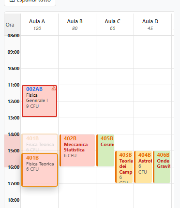

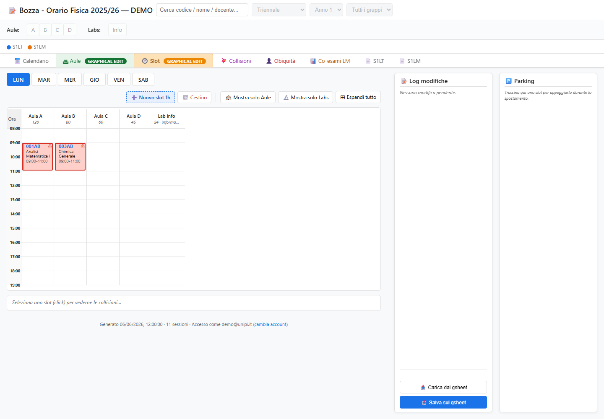

### Collisioni

Report (sola lettura) delle sovrapposizioni d'orario, con la **funzione di costo**
in cima (totale `ore × studenti-in-comune` a settimana). Le collisioni fra
**obblighi** sono **sempre** mostrate come **lista** (se non ce ne sono, una sezione
**OBBLIGHI–OBBLIGHI** lo dice esplicitamente: «— nessuna collisione —»); il toggle in
alto cambia solo le *forchette*:
- **📋 Mostra solo liste** — tutto a lista (per Piano di Studi).
- **▦ Mostra matrice forchette** (default) — obblighi a lista + le collisioni con le
  forchette come **matrici** (OBBLIGHI–FORCHETTE e FORCHETTE–FORCHETTE), più la
  matrice **OPZIONALI–TUTTI** (opzionali × tutti gli esami, non valorizzata).

**Vista Lista**: raggruppata **per Piano di Studi** (una sezione per PdS, più
**Triennale** per gli obblighi LT). Dentro ogni gruppo, **tutte** le collisioni
(OBB-OBB, OBB-FOR, FOR-FOR) in **ordine di costo decrescente**, **incluse** quelle a
**costo 0** (nessuno storicamente segue la combinazione) e **n/d** (codice non in
matrice). Ogni riga: giorno/orario, la **cella costo** (`ore × N`, rosso se N≥5), i
due insegnamenti (chip rosso = obbligo, giallo = forchetta). **Passando sopra la
cella costo** appare un popover con gli spostamenti che ridurrebbero il costo.

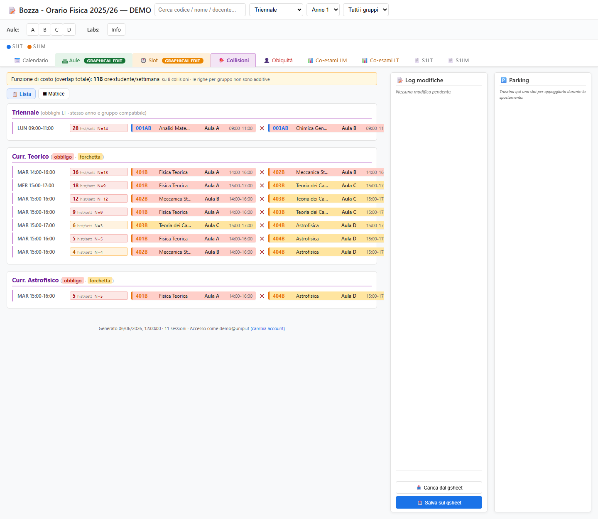

**Vista Matrice** (default): due matrici **codice × codice**, una per
**OBBLIGHI–FORCHETTE** (obblighi sulle righe, forchette sulle colonne) e una per
**FORCHETTE–FORCHETTE**. Quest'ultima è una **matrice quadrata** con gli **stessi
codici su righe e colonne**, ma valorizzata **solo nella parte sopra la diagonale**
(la metà inferiore è il duplicato speculare; la prima colonna e l'ultima riga
restano quindi senza valori): ogni coppia compare una volta sola. L'ordine dei codici non conta (la collisione
è la stessa); il **giorno** invece sì: variazioni su giorni/orari diversi sono
*varianti distinte*. Ogni cella mostra il **costo totale** `N × ore` (somma delle
varianti), con heatmap ambra e **rosso se N≥5**. Vengono riportate **solo le
collisioni con costo > 0**: le caselle a costo 0 e quelle senza dato (`n/d`)
restano **vuote** (così non confondono). **Clic su una cella** → a **destra** della
matrice compaiono tutte le varianti, ognuna con: **giorno/orario**; il **costo per
esteso** (es. «Costo 18 ore·studente/settimana, N=9 studenti in overlap storico per
2 ore», in rosso se N≥5) con il **Piano di Studi a destra**; e sotto i **due slot**
su righe distinte (codice + titolo, e aula · orario).

Ogni matrice riporta le **somme di riga** (colonna **Σ** a destra), le **somme di
colonna** (riga **Σ** in basso) e il **totale** della matrice nell'**angolo in basso
a destra** (evidenziato). Le caselle speculari `/2` contano **metà**, quindi i totali
sono **additivi**: la somma dei totali di OBBLIGHI–FORCHETTE + FORCHETTE–FORCHETTE +
gli obblighi-obblighi (a lista) coincide con il **totale del banner**.

> **Sezioni additive (niente doppi conteggi).** Una stessa collisione può cadere
> in categorie diverse a seconda del Piano di Studi — un codice può essere
> **obbligo** in un curriculum e **forchetta** in un altro. Per non contarla due
> volte, ogni collisione è assegnata a **una sola** sezione con precedenza
> **OBB-OBB › OBB-FOR › FF**: se compare già negli obblighi (o negli
> obblighi-forchette) **non** viene ripetuta nelle forchette-forchette. Le tre
> sezioni diventano così mutuamente esclusive **a livello di collisione**, come il
> **totale del banner** (che conta ogni collisione una sola volta).
>
> Inoltre, dentro ogni **cella** della matrice le **varianti per-gruppo** dello
> stesso clash (stesso giorno/orario) vengono **accorpate**: hanno la stessa `N`,
> quindi contano una volta sola (contarle due volte raddoppierebbe gli stessi
> studenti). Le singole righe per-gruppo restano visibili solo nelle **liste**,
> come dettaglio.
>
> **Caselle speculari "/2".** La matrice OBBLIGHI–FORCHETTE è bipartita (obblighi
> sulle righe, forchette sulle colonne), ma un codice può essere **obbligo in un
> PdS e forchetta in un altro**. Quando questo vale per *entrambi* i codici di un
> clash, lo stesso scontro `X·Y` comparirebbe in due caselle speculari —
> `X-obbligo × Y-forchetta` **e** `Y-obbligo × X-forchetta`. Le mostriamo
> **entrambe** (è la stessa collisione vista da due curricula), ma ognuna riporta
> il valore **dimezzato** con la notazione **`/2`** (es. `2/2`): così la **somma
> delle celle coincide col totale del banner**. Le due caselle sono **collegate**:
> selezionandone una si evidenzia anche l'altra e il pannello a destra elenca
> **assieme** le varianti delle due orientazioni.

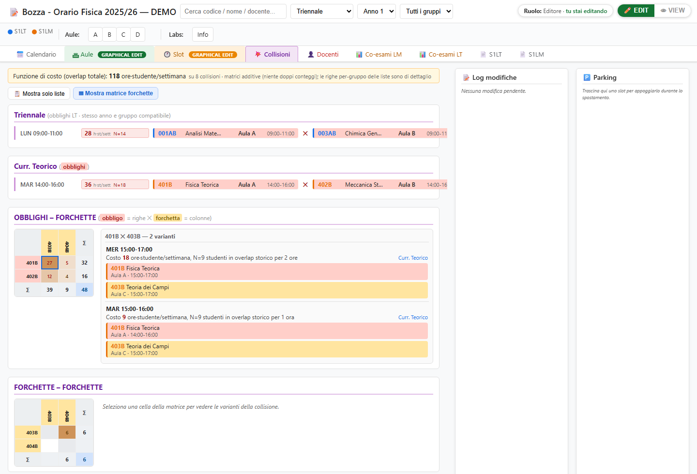

In fondo, una terza matrice **OPZIONALI – TUTTI** (sempre nella vista matrice):
in **colonna** gli **opzionali** (vincolo `OPZ` dei Piani di Studi), in **riga**
**tutti** gli esami del PdS — obblighi, forchette e gli opzionali stessi. A
differenza delle due precedenti, queste collisioni **non sono valorizzate**: la
cella mostra solo la **presenza** di una sovrapposizione d'orario (`●`, o il
numero di varianti se più d'una), **senza costo**. Serve a vedere **con quante
cose collide ciascun opzionale** e collocarlo dove disturba meno: il **badge in
testa a ogni colonna** conta gli esami in collisione e lo **sfondo verde della
colonna** è tanto più scuro quante più collisioni ci sono (le colonne sono
ordinate dalla peggiore). Le **righe** sono raggruppate e colorate per ruolo
(obbligo rosso, forchetta giallo, opzionale verde). Il sotto-blocco
**opzionale × opzionale** è simmetrico, quindi — come per la matrice FF — ne viene
mostrata **solo la parte sopra la diagonale**; le righe di obblighi e forchette
restano invece **intere**. Il **badge** in testa a ogni colonna resta comunque il
**totale reale** delle collisioni di quell'opzionale (conta entrambi i versi),
anche se metà delle celle opz-opz è nascosta. **Clic su una cella** →
le varianti compaiono a **destra**, come per le altre matrici.

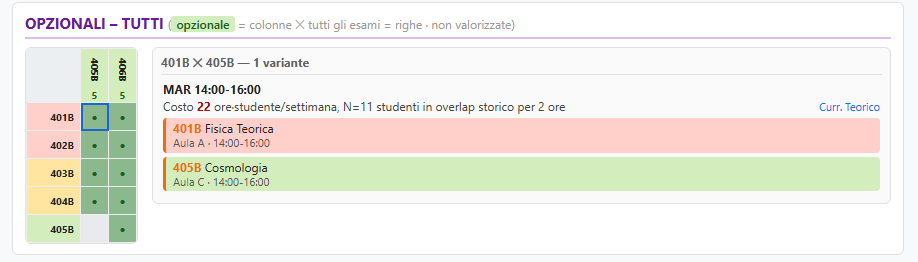

> **Perché alcuni costi sono `n/d`?** Non significa che manca tutta la matrice (se
> mancasse, il banner lo direbbe). `n/d` compare quando **uno dei due codici non è
> nel foglio `MATRICE`**: o è stato escluso dai filtri del tool (non termina in B e
> non è in `EXTRA_CODES`), oppure non ha storico esami negli AA/coorti scelti.
> Rimedio: aggiungere il codice a `EXTRA_CODES` (se legittimo) e/o rivedere
> AA/coorti, poi rigenerare la matrice e re-importarla.

### Docenti

Tab **👤 Docenti** (ex "Obiquità"): **collisioni docente** — stesso docente (titolare
*o* co-docente) in due slot **sovrapposti** (l'ubiquità non esiste). Raggruppati per
docente; le collisioni fra slot dello **stesso codice** sono escluse (falsi positivi).

In una **seconda sezione — «Servizio — corsi fuori dipartimento»** — sono elencate le
collisioni fra un corso interno e un **impegno di servizio** del suo docente (dalla
tabella `SERVIZIO`): stesso docente, stesso giorno, **orari sovrapposti**. Ogni riga
mostra il corso interno ✕ l'impegno esterno (chip viola), col tag **⚠ servizio**. Se la
tabella `SERVIZIO` non è caricata, la sezione lo segnala.

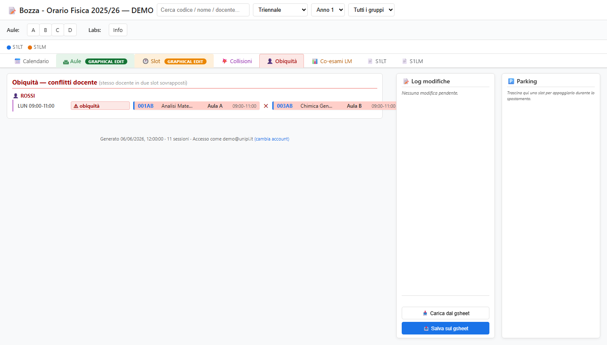

### Co-esami LM

**Matrice** dei codici LM obbligatori/forchetta del semestre (intestazione
**"Matrice di co-esami (obblighi+forchette)"**, come la LT è etichettata
*(opzionali)*). **Diagonale** = `E`
(numero esami sostenuti, sui 3 AA); **fuori diagonale** = `N` (studenti che hanno
sostenuto **entrambi**). Heatmap ambra a partire dalla **soglia** impostabile nel
campo *"colore da N ≥"* (default 2, persistita). Lo sfondo della casella del codice
è colorato per vincolo (rosso OBB / giallo FOR); la casella in alto a sinistra è
quadrata. **Passando sopra un codice** (riga o colonna) compare un popover con i
dettagli del corso (titolo, docenti, settore, E…).

> **Tutti i co-esami vengono importati.** Il foglio `MATRICE` viene letto **per
> intero** — *tutti* i codici e *tutte* le coppie (opzionali compresi; i mutuati
> rimappati sul capostipite), **senza filtri di vincolo**. Il tab LM **mostra** solo
> il sottoinsieme **obblighi+forchette** e il tab LT i soli **opzionali**, ma il
> dato completo (`perCode`/`pairs`) resta in memoria e alimenta i calcoli di costo.

**Selezione (clic)** → a destra compare un pannello:
- **clic su una casella** (coppia): «*N* studenti hanno sostenuto sia l'uno sia
  l'altro», con i **due esami** come chip (codice, titolo, CFU);
- **clic su un codice** (header riga/colonna o diagonale): info del corso + **numero
  esami sostenuti** e l'elenco «*fra questi studenti, molti hanno anche sostenuto…*»
  (gli altri esami con il numero di studenti in comune, in ordine).

Lo spazio a destra è diviso in **due colonne**: a sinistra il pannello dettaglio
qui sopra, a destra **«Piani di studio attivi»** con una **checkbox per ogni PdS**
(più i pulsanti *Tutti* / *Nessuno*). Deselezionando dei PdS, ogni esame che **non
è più citato da alcun PdS attivo** viene **spento** nella matrice: **riga, colonna
e intestazioni diventano grigie** (i valori restano, ma de-enfatizzati). Gli esami
non citati da nessun PdS (presenti per altra via) non si spengono. *Funzione della
sola matrice LM* (la LT non usa i Piani di Studio).

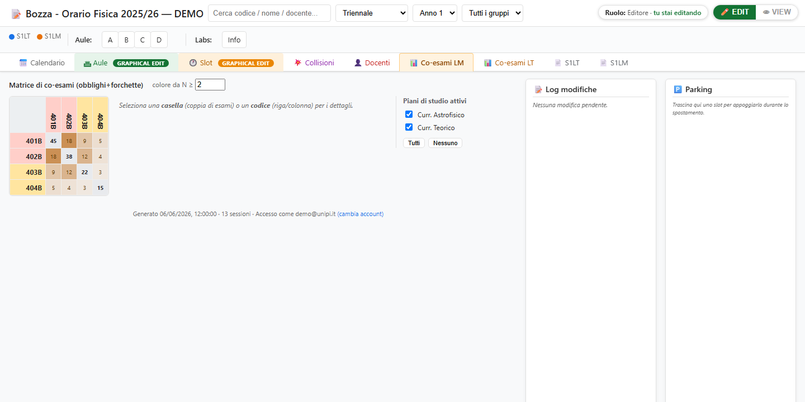

### Co-esami LT

Identica alla Co-esami LM, ma per la **Triennale** e ristretta ai **soli opzionali
(OPZ)** della LT: utile per valutare le sovrapposizioni fra esami a scelta. Stessa
logica (E in diagonale, N fuori, heatmap da soglia, hover sui codici); intestazioni
codice in **verde** (colore OPZ). La soglia colore è **indipendente** da quella LM.

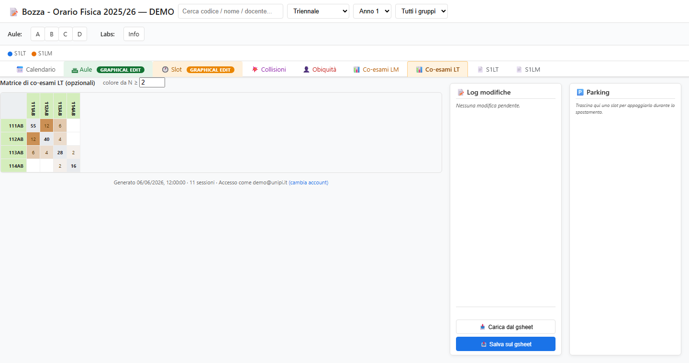

### S1LT / S1LM (specchio)

Riproduzione "a schede" del contenuto del gsheet, una **card per codice**: testata
con codice/titolo/docenti/CFU/settore, righe per TIPO/Vincolo/Gruppo con i **badge
orari** (aula + ora), **totale ore** per riga e per codice. Il rapporto **ore/CFU**
è colorato (rosso se < 2h ogni 3 CFU). Ordinamento per **Codice** o **Ore/CFU**;
il campo Cerca filtra anche qui.

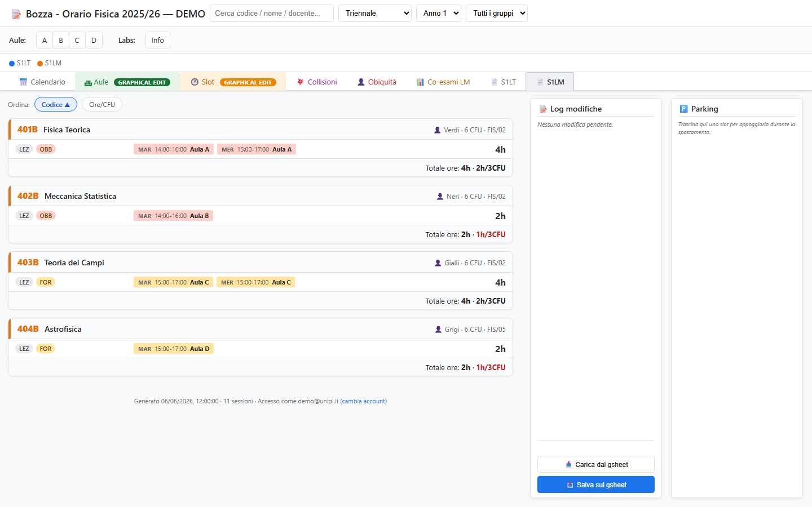

---

## 5. Capienza delle aule

Per ogni slot con aula avente capienza nota:

```
studenti effettivi = E (diagonale matrice) ÷ n. gruppi
   n. gruppi = 1 (nessun gruppo) · 2 (gruppo a una lettera, es. "A") · 4 (lettera+numero, es. "A1")
sovraffollamento  = studenti effettivi > 80% della capienza
```

La capienza è il **2° campo della cella aula** in `SxAULE` (dopo il nome, a capo).
Gli slot sovraffollati hanno bordo rosso + ⚠ nel tab **Slot**; selezionando lo slot
si vedono i numeri (E, ÷gruppi, posti, %).

> Nota: `E` è la **somma sui 3 AA**. Per la capienza interessa di solito il dato
> *annuale*; se serve, si può dividere `E` per il numero di AA nel calcolo capienza.

---

## 6. Funzione di costo e matrice co-esami

```
costo collisione = ore_sovrapposte_a_settimana × N      [ore·studente/settimana]
```

- `N` = studenti che hanno sostenuto **entrambi** gli esami (dalla matrice).
- coppia **assente** in matrice fra due codici presenti → **0** (nessuna stima);
  codice **non in matrice** → **n/d** (contribuisce 0 al totale).
- La web app **conserva l'intero dataset** del foglio `MATRICE` (tutti i codici,
  LT inclusi): il tab Co-esami ne mostra solo il sottoinsieme LM OBB/FOR, ma `E`/`N`
  di tutti i codici sono disponibili (servono p.es. alle capienze dei corsi LT).

### Classi di equivalenza = mutuazioni

Più codici che sono **lo stesso esame** (es. versioni *short/long*, oppure un corso
condiviso **LT↔LM**) vanno trattati come **uno solo**. La web app usa a questo scopo
le **mutuazioni** (colonna **D — "Codice mutuato"**): tutti i membri di un gruppo di
mutuazione (capostipite + mutuanti) formano una **classe di equivalenza**. Effetti
automatici, ovunque (matrici co-esami, capienza, collisioni):

- **E** della classe = **somma** delle E dei membri; **N** verso un altro esame =
  **somma** delle N dei membri (le versioni si escludono a vicenda → nessun doppio
  conteggio). La matrice mostra il **codice citato nel Piano di Studi** (il mutuante),
  non il capostipite-sorgente: i dati restano quelli aggregati della classe.
- **Capienza**: usa la E della classe (i mutuanti seguono le lezioni del capostipite).
- **Collisioni**: due membri della stessa classe **non** collidono fra loro; verso
  gli altri contano come **un unico esame**. Le lezioni reali di un codice mutuato
  (che stanno sul foglio del capostipite, es. un obbligo LM mutuato da un corso LT)
  **partecipano comunque** alle collisioni del PdS che le cita.

> Quindi per "unire" esami corrispondenti basta dichiararli **mutuati** dello stesso
> capostipite — nessuna tabella aggiuntiva da mantenere.

---

## 7. Pipeline della matrice (tool Python)

La matrice **non** si compila a mano: si genera dall'export Esse3.

```
FISICA_MONIT_CAR_TAB.csv (export Esse3 completo, pipe-delimited, Latin-1)
        │  python matrice/genera_matrice_esami_lm.py [csv] [--coorti=2022,2023]
        ▼
matrice/MatriceEsamiLM.csv   (matrice quadrata, conteggi interi)
        │  incolla / importa
        ▼
gsheet FISSO della matrice   (un solo file condiviso)
        │  =IMPORTRANGE(...) in A1 del foglio "MATRICE" di ciascun orario
        ▼
foglio "MATRICE"  →  getOrarioData → readCoexamMatrix_  →  Web App
```

Filtri del tool (vedi `matrice/README.md`): AA di superamento **2022/23–2024/25**;
**coorti** opzionali (`AA_IMM1`); codici che **terminano in B** + eccezioni
(`EXTRA_CODES`); **tutte le carriere** (LT + LM) → `E`/`N` per ogni codice.
`E` ed `N` sono **somme intere** sui 3 AA (niente medie/decimali, per evitare
problemi di locale all'import in Sheets).

Dopo aver aggiornato la matrice: autorizza l'`IMPORTRANGE` (una volta per gsheet) e
fai **Carica/Pubblica** nell'orario.

---

## 8. Pubblicazione e deploy

Due comandi, **non** equivalenti:

- **`npm run push`** — manda il codice su Apps Script (solo `@HEAD` / URL `/dev`).
  **Non** aggiorna la web app pubblica.
- **`npm run deploy`** — `push` **+** `clasp deploy` → **nuova versione del
  deployment** → la URL `/exec` (quella che usano gli utenti) serve il codice nuovo.
  **Usa sempre questo** dopo una modifica.

**Da VS Code (senza scrivere comandi).** *Terminale → Esegui attività…* (oppure
`Ctrl+Shift+P` → *Tasks: Run Task*) mostra le attività di `.vscode/tasks.json`. Le principali
per lavorare in autonomia:

- **Verifica (sintassi + sim)** — `npm run verify`: controlla la sintassi del client (gli
  `<script>` di `index.html`), di tutti i `.gs`, e lancia tutte le sim. Esce con errore se
  qualcosa non va. È anche la *Run Test Task* di default.
- **Verifica + Deploy** — esegue la verifica e, **solo se passa**, fa `npm run deploy` sui
  target. (È il modo consigliato per deployare da soli.)
- **Git: commit (messaggio)** — chiede un messaggio, poi `git add -A` + `git commit`.

I target sono in `config/local.json` (3 installazioni, ognuna con `scriptId` +
`deploymentId` + `webappUrl`). Per aggiornare la web app pubblica serve un
`deploymentId` valorizzato (altrimenti il target resta "push-only").

Dal foglio: menu **🕒 Orario → 📅 Vai al Web Calendar** rilegge il gsheet e
riscrive lo snapshot (utile dopo modifiche manuali).

Menu **🕒 Orario → 🔓 Sconnetti editor**: forza il rilascio del lock di modifica
(vedi §3). Serve se un editor è rimasto "appeso" (scheda chiusa senza uscire da EDIT)
e blocca l'EDIT agli altri — anche se il lock scade comunque da solo dopo ~24 h.

Menu **🕒 Orario → 🔁 Import / Export**: salva/ripristina un **backup JSON** dei fogli
sorgente (`SxLT`/`SxLM` + PdS) nello **stesso folder Drive** del gsheet.
- **📤 Esporta JSON** e **📥 Importa JSON** aprono un dialogo che chiede il **nome del
  file**: è già compilato col **nome del gsheet** (default) ma resta **editabile**, così
  puoi tenere più backup con nomi diversi (l'estensione `.json` è aggiunta in automatico).
- In import, dopo aver scelto il nome il dialogo mostra **cosa verrà sostituito** e chiede
  conferma prima di scrivere. La `MATRICE` non viene mai reimportata (è alimentata da
  IMPORTRANGE); dopo l'import vengono rigenerati `SxAULE` e lo snapshot della web app.

---

## 9. Struttura del codice e verifiche

```
src/                  codice Apps Script
  index.html          web app (client: UI, render, editing) ~3800 righe
  WebApp.gs           doGet, getOrarioData, snapshot (bucket LT/LM/PDS), Carica/Salva
  Config.gs           costanti colonne, parser (parseDocenti_, parseMutuazione…)
  TabellaAule.gs      generazione foglio SxAULE
  Coexam.gs           lettura foglio MATRICE
  Menu.gs, …          menu del foglio, utilità
matrice/              tool Python + README della matrice co-esami
scripts/              push.js / deploy.js (multi-target) + sim_*.js + build_manual_screens.js
docs/img/             screenshot del manuale
```

**Verifiche senza eseguire su Google** (`scripts/sim_*.js`, eseguono le funzioni
reali estratte da `index.html` in un DOM finto):

| Sim | Copre |
|-----|-------|
| `sim_collisions.js` | costo, ordinamento, raggruppamento varianti, matrice opzionali×tutti, obiquità (multi-docente, stesso-codice) |
| `sim_coexam.js` | matrice: soglia colore, header colorati, corner quadrato, hover codici |
| `sim_capacity.js` | capienza aule (divisori gruppo, soglia 80%) |
| `sim_suggest.js` | suggerimenti di spostamento + popover collisioni |
| `sim_drag.js`, `sim_mirror.js`, `sim_modlog.js` | drag/parking, schede specchio, log modifiche |

Esecuzione tipica prima del deploy:

```
node scripts/sim_collisions.js   # … e gli altri sim
npm run deploy
```

---

## 10. Rigenerare gli screenshot del manuale

Gli screenshot sono catturati dalla UI reale, resa in standalone con dati mock:

```
node scripts/build_manual_screens.js          # → .manual_preview/index.html (verifica sintassi)
```

Poi con Edge headless (Windows): copiare `.manual_preview/index.html` in un path
**senza spazi/parentesi** (es. `%TEMP%\orario_manual\`) e catturare ogni tab via
hash (`#rooms`, `#slots`, `#collisions`, `#ubiquity`, `#coexam`, `#mirror0`,
`#mirror1`), salvando in `docs/img/`. Per ispezionare/debuggare la resa è disponibile
il server di anteprima (`.claude/launch.json`, dir `.manual_preview`).

---

> **Manutenzione del manuale.** Quando una modifica cambia l'uso o l'aspetto della
> web app, **aggiornare questo file** (testo e, se l'interfaccia è cambiata, gli
> screenshot in `docs/img/`).
